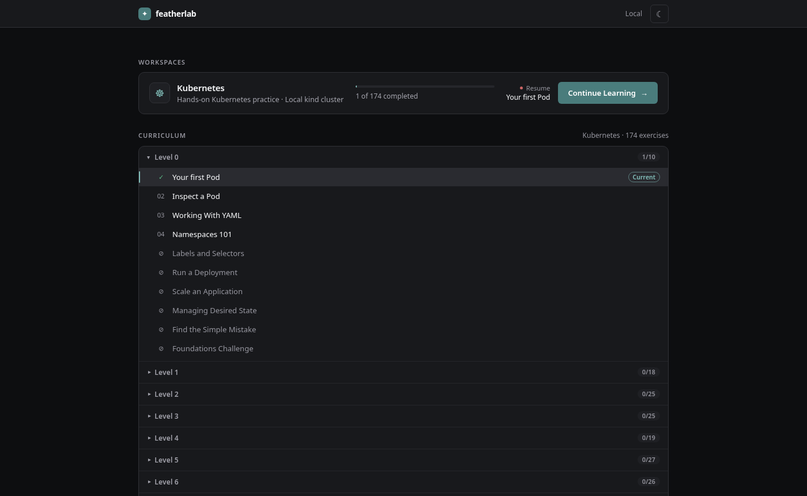
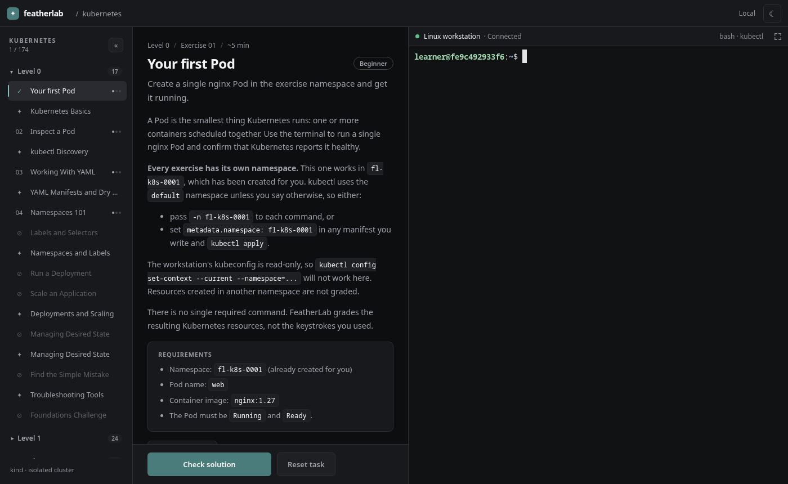
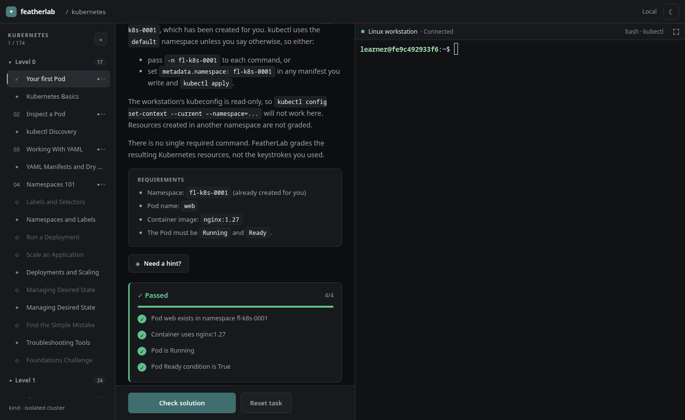

# FeatherLab

**Free, open-source (MIT) Kubernetes practice labs** — spin up a real [kind](https://kind.sigs.k8s.io/) cluster on your machine and learn Kubernetes with 170+ guided exercises, automated grading, and no cloud account required.

**Landing page:** https://karuifeather.github.io/featherlab/  
**Install:** `npm install -g featherlab`

A local-first Kubernetes learning environment. Real cluster, real kubectl, guided exercises, and automated grading toward CKA, CKAD, CKS, KCNA, and KCSA.

## What is FeatherLab?

FeatherLab is a self-contained Kubernetes learning environment that runs on your machine. It manages a [kind](https://kind.sigs.k8s.io/) cluster and a browser-based workspace so you can develop real Kubernetes skills without signing up for a hosted platform or provisioning cloud infrastructure.

Every exercise runs against an actual Kubernetes cluster. When you create a Deployment, it schedules Pods. When you misconfigure a probe, it fails. When you fix a broken service selector, traffic flows. Grading inspects actual cluster state — not commands typed, not simulated output.

The curriculum is structured to build skill progressively: guided labs introduce concepts one or two at a time, independent exercises apply them, troubleshooting tasks require diagnosis, and mastery activities combine what you have learned. Interleaved knowledge checks reinforce commands, flags, and operational reasoning. Progress is tracked locally in SQLite and survives restarts.

FeatherLab is being developed toward broad coverage of CKA, CKAD, CKS, KCNA, and KCSA — the CNCF Kubernetes certification family. The current curriculum covers foundations through advanced networking. Storage, RBAC, cluster administration, and security hardening are planned.

## What you can do

**Practice on real Kubernetes.** Work against a real kind cluster using `kubectl`. No simulation layer, no fake terminal.

**Learn progressively.** Move through levels that introduce one concept at a time before combining them or breaking them on purpose.

**Solve hands-on challenges.** Create, modify, troubleshoot, and recover Kubernetes resources — Pods, Deployments, Services, Ingress, NetworkPolicies, and more.

**Get meaningful feedback.** Checks inspect actual Kubernetes state. A check that fails tells you what it found, not just "wrong".

**Build command fluency.** Knowledge checks cover `kubectl` commands, flags, output formats, and operational decisions — not just recall, but choosing the right tool.

**Track progress.** Completion, attempt history, and prerequisite unlocking are stored locally and persist across sessions. Start where you left off.

**Work locally.** No account required, no data sent to a server, no time limit.

**Resume safely.** Reopening an exercise you already started leaves your work intact. Switching to a different exercise prepares a fresh environment. The cluster and its workloads are preserved across `featherlab stop` and restart.

## See it in action



_The launcher shows your progress across levels and resumes where you left off._



_Each exercise has a description, requirements, and a live terminal connected to a real Kubernetes cluster._



_Grading checks actual cluster state and tells you exactly which conditions passed or failed._

## Getting started

### Prerequisites

- Linux. macOS is exploratory but not regularly tested. Windows and WSL2 are not validated.
- [Node.js](https://nodejs.org/) 22.14 or later and npm.
- [Docker Engine](https://docs.docker.com/engine/install/) with the daemon running and accessible to the current user (`docker info` should succeed).
- [kind](https://kind.sigs.k8s.io/docs/user/quick-start/) CLI. Version 0.33.0 is recommended.
- Internet access on first launch and when opening Level 6 exercises for the first time (kind node image, workstation image, and Traefik). Most subsequent use is offline if images are cached.

### Install

```bash
npm install -g featherlab
featherlab doctor
featherlab
```

`featherlab doctor` checks that Docker and kind are reachable. `featherlab` (or `featherlab start`) creates the practice cluster on first launch, starts the browser workspace, and opens `http://127.0.0.1:4317` in your default browser.

Later launches reuse the existing cluster and workstation.

### What happens on start

1. FeatherLab checks prerequisites and provisions the kind cluster if it does not exist.
2. A non-root workstation container joins the cluster's Docker network. This is where you run `kubectl`.
3. A local HTTP server starts and opens the browser workspace.
4. The launcher shows your progress and resume state. Select an exercise to begin.

### Removing FeatherLab

```bash
featherlab stop
docker rm featherlab-workstation
kind delete cluster --name featherlab
rm -rf ~/.featherlab          # kubeconfigs, progress database, PID file
npm uninstall -g featherlab
```

## CLI

```bash
featherlab                     # start workstation and open browser (alias: featherlab start)
featherlab stop                # gracefully stop a running instance, or stop containers directly
featherlab doctor              # check Docker and kind prerequisites
featherlab status              # show cluster and workstation state
featherlab exercises           # list available exercises
featherlab reset [id] [--yes]  # reset an exercise (default: k8s-0001); --yes takes the environment from another
featherlab update              # upgrade to the latest version from npm
featherlab --version
featherlab --help
```

`featherlab update` refuses to run while a server is active — stop it first. Commands other than `start` and `update` never make network requests.

Three environment variables override defaults:

| Variable               | Default                                                 | Notes                                    |
| ---------------------- | ------------------------------------------------------- | ---------------------------------------- |
| `FEATHERLAB_IMAGE`     | `ghcr.io/karuifeather/featherlab-workstation:<version>` | Workstation image                        |
| `FEATHERLAB_PORT`      | `4317`                                                  | HTTP port                                |
| `FEATHERLAB_STATE_DIR` | `~/.featherlab`                                         | Kubeconfigs, progress database, PID file |

## What's included

174 hands-on exercises and 54 knowledge checks across eight levels:

| Level | Theme                                                                               | Exercises | Checks |
| ----- | ----------------------------------------------------------------------------------- | --------- | ------ |
| 0     | Kubernetes foundations — Pods, namespaces, labels, Deployments                      | 10        | 7      |
| 1     | Deployment lifecycle — rolling updates, rollback, release management                | 18        | 6      |
| 2     | Configuration, health, and recovery — ConfigMaps, Secrets, probes                   | 25        | 6      |
| 3     | Application patterns — init containers, native sidecars, Jobs, CronJobs, DaemonSets | 25        | 7      |
| 4     | Resource management and scheduling — requests, limits, QoS, affinity, HPA           | 19        | 8      |
| 5     | Services and DNS — ClusterIP, EndpointSlices, DNS, blue/green, canary               | 27        | 7      |
| 6     | Ingress and Gateway API — HTTP routing, TLS, cross-namespace routing                | 26        | 6      |
| 7     | NetworkPolicy — default-deny, egress, namespace selectors, multi-tier isolation     | 24        | 7      |

Each level mixes guided labs, independent exercises, troubleshooting, and mastery activities. Knowledge checks are interleaved throughout rather than grouped at the end.

See [docs/curriculum.md](docs/curriculum.md) for the full exercise list with prerequisites, difficulty ratings, and skill coverage notes.

## What's coming

The current curriculum ends at Level 7. In development:

- **Level 8 — Storage**: PersistentVolumes, PersistentVolumeClaims, StorageClasses, stateful workloads.
- **Level 9 — ServiceAccounts and RBAC**: permissions, roles, bindings, and admission basics.
- **Level 10 — Kustomize, Helm, and CRDs**: packaging and delivering applications.
- **Levels 11–12**: Integrated CKAD mastery and structured troubleshooting.
- **Levels 13–15**: Cluster administration, node maintenance, etcd, and CKA readiness.
- **Levels 16–21**: Cloud-native security, workload hardening, supply chain, and CKS readiness.

The long-term goal is to cover all five CNCF certifications through original, verified lab content. Progress is made in small batches: each exercise is validated on a real cluster before release.

## Safety and local use

FeatherLab is a **single-user, local-first tool**. It is not a multi-tenant sandbox and makes no attempt to defend against the learner.

- Run it on a trusted machine. The CLI controls Docker on your host.
- The default server binds to `127.0.0.1:4317`. Do not expose it over a public tunnel or bind it to a public address.
- The learner workstation holds cluster-admin credentials for the dedicated practice cluster. That cluster is isolated and disposable; it holds no real data.
- `featherlab reset` deletes and recreates only the namespaces owned by the target exercise. Your cluster, other namespaces, and workstation files are never touched.
- kind must be installed separately. FeatherLab does not auto-download it.

See [docs/security.md](docs/security.md) for the full threat model and operational safety rules.

## Development and contributing

| Document                                     | Covers                                                             |
| -------------------------------------------- | ------------------------------------------------------------------ |
| [docs/development.md](docs/development.md)   | Building from source, testing, project structure, release workflow |
| [docs/architecture.md](docs/architecture.md) | Module boundaries, lifecycle, persistence, frontend progression    |
| [docs/authoring.md](docs/authoring.md)       | Adding exercises, validators, and tracks                           |
| [docs/curriculum.md](docs/curriculum.md)     | Implemented curriculum with full exercise tables                   |
| [docs/security.md](docs/security.md)         | Threat model, trust boundaries, lifecycle safety                   |

Issues and pull requests: [github.com/karuifeather/featherlab](https://github.com/karuifeather/featherlab)
